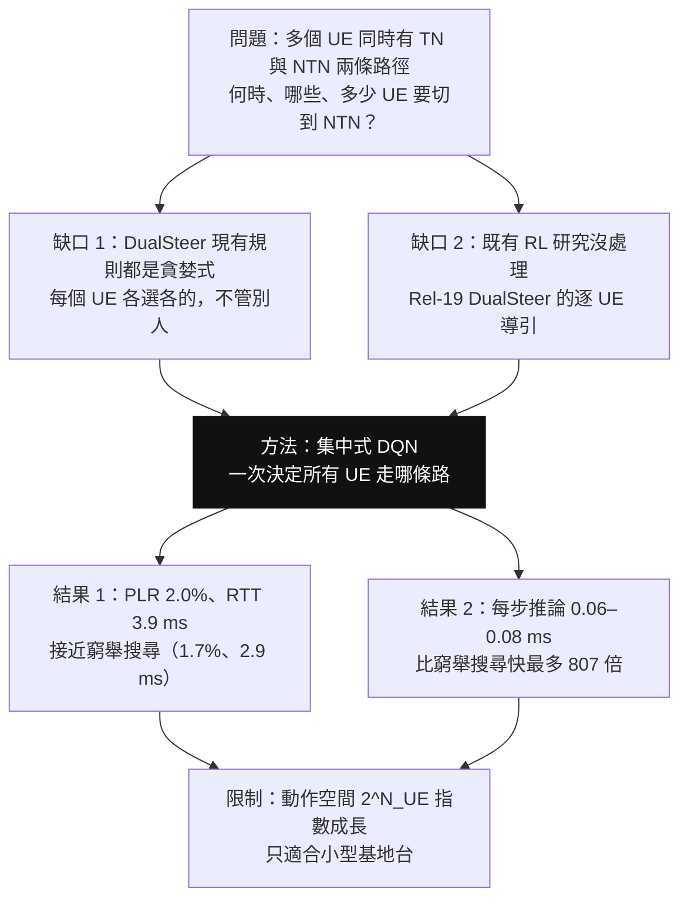
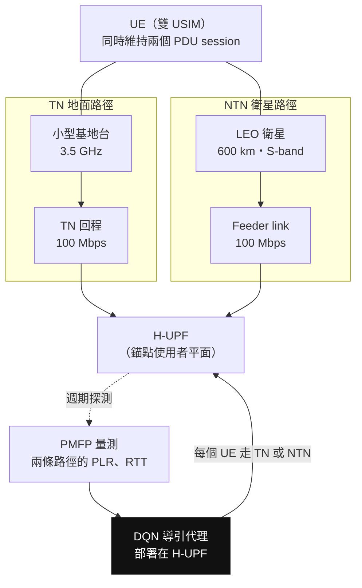
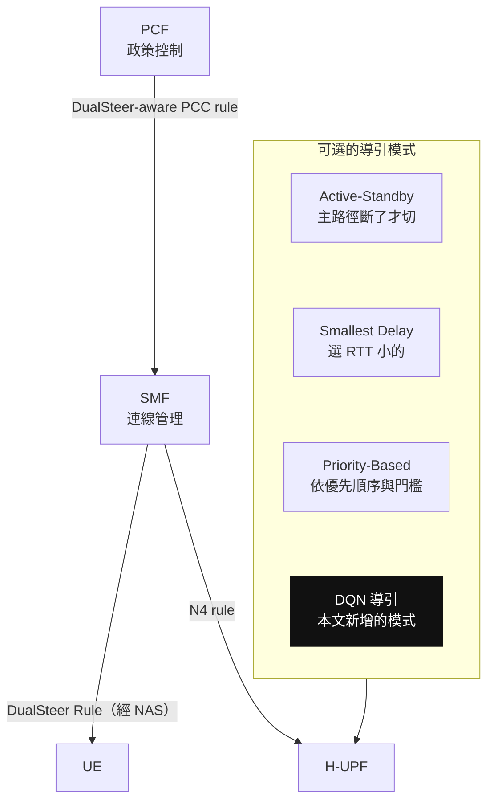
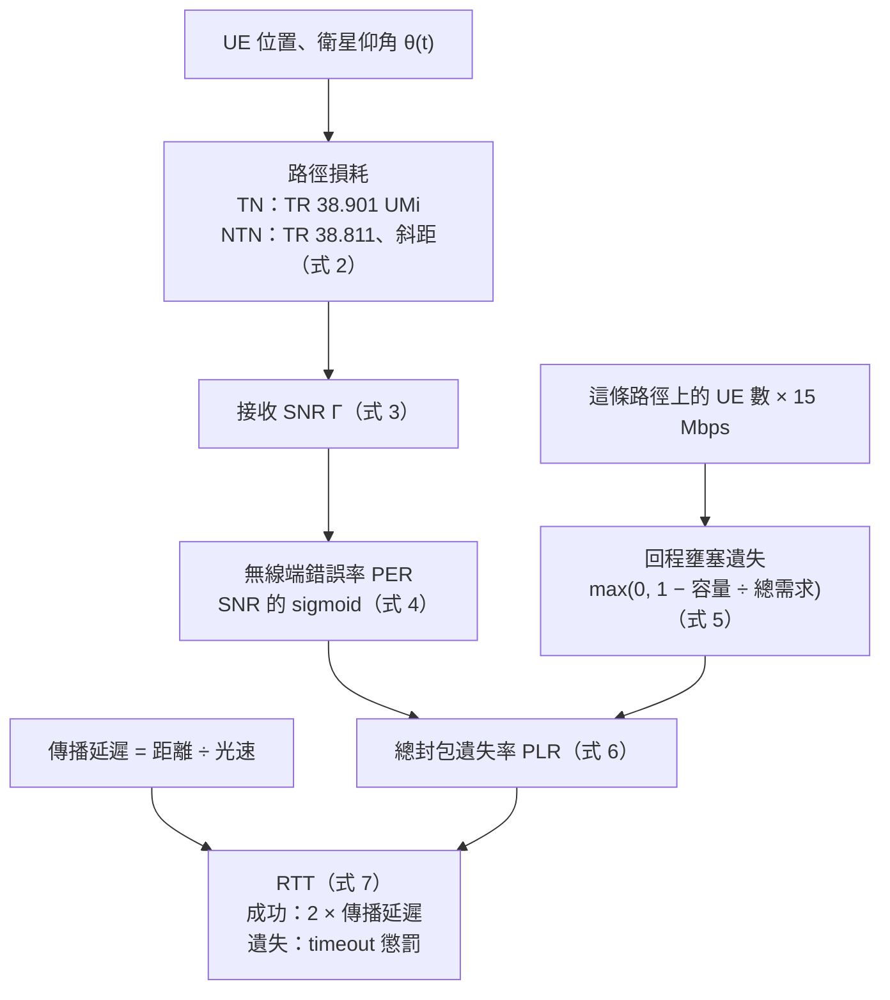
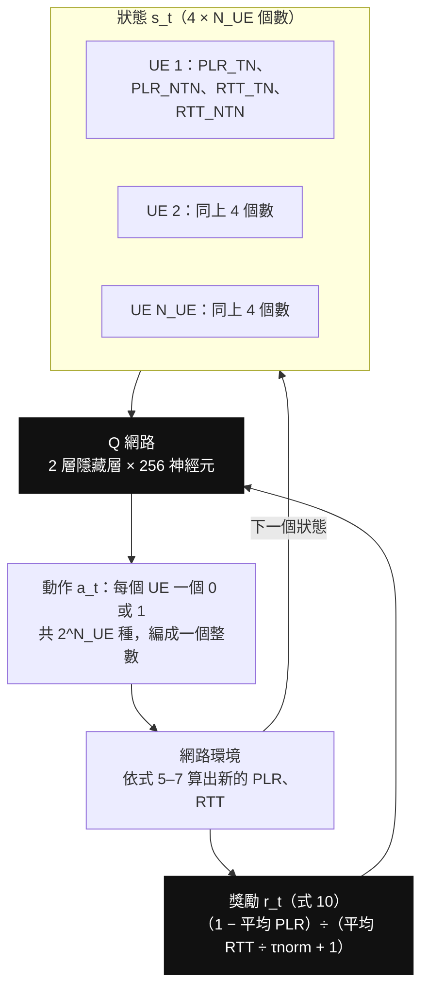
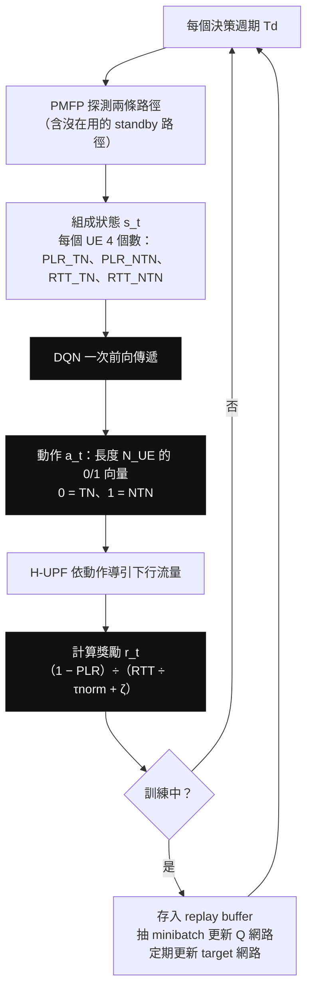

# ① 一句話總結

在 3GPP Release 19 的 DualSteer 架構下，用一個集中式 DQN 代理，同時決定每個使用者的下行流量走地面網路（TN）還是低軌衛星（NTN），**在地面回程塞車之前就先把一部分使用者分流到衛星**，封包遺失率比 3GPP 的 Smallest Delay 規則低 79%。

# ② 問題卡

- **研究問題**：多個使用者（UE）同時擁有 TN 與 NTN 兩條路徑時，**何時、哪些、多少** UE 要切到 NTN，才能同時兼顧可靠度（PLR）與延遲（RTT）？（p.1）
- **為什麼重要**：TN-NTN 整合是 6G「到處都有網路」的核心技術；Rel-19 DualSteer 讓 UE 用兩張 USIM 同時維持 TN 與 NTN 兩個連線。在災區、海上這類小型基地台場景，地面回程容量有限，很容易塞車。（p.1–2）
- **舊方法的缺點**：
  - DualSteer 現有三種規則式模式（Active-Standby、Smallest Delay、Priority-Based）都是**貪婪式**：每個 UE 各自挑當下比較好的路徑，不管其他 UE 的選擇。（p.1）
  - Smallest Delay 因為地面傳播延遲永遠比衛星短，幾乎把所有 UE 都丟到 TN，結果造成 TN 回程壅塞。（p.1）
  - 既有 RL 研究：LEO 換手只考慮單一 UE；地面 RAT 選擇沒考慮衛星的 RTT 不對稱與仰角變化；衛星－地面資源管理處理的是排程／容量，不是逐 UE 的流量導引。（p.2）
- **本文貢獻**：
  1. 把 DualSteer 下行導引寫成 MDP，集中式代理觀測兩條路徑的 PLR／RTT，**一次決定所有 UE 的路徑**，考慮到 UE 之間的負載耦合。（p.2）
  2. 提出「可靠度／延遲效率」獎勵函數，把封包遺失和延遲合成單一指標。（p.2、式 10）
  3. 模擬顯示 PLR 大幅低於所有規則式方法，接近窮舉搜尋，但推論快最多 807 倍。（p.2、p.7）

# ③ 架構圖

## 圖 1　論文脈絡圖

## 圖 2　系統架構圖

## 圖 3　控制平面：導引規則怎麼下發

## 圖 4　PLR 與 RTT 怎麼算出來

## 圖 5　MDP 設計：狀態、動作、獎勵

## 圖 6　方法流程圖：DQN 的訓練與決策迴圈

# ④ 方法重點

| 方塊 | 在做什麼 | 頁碼 |
|---|---|---|
| DualSteer 架構 | 每個 UE 有兩張 USIM、兩個 PDU session，綁成一個 DSG。只能「切換」不能「分流」，同一時間每個 UE 的下行只走一條路徑（式 1：x_i(t) = 0 為 TN、1 為 NTN）。 | p.2 |
| 控制平面 | PCF 下發 DualSteer PCC rule 給 SMF，SMF 轉成 DualSteer Rule（經 NAS 給 UE）與 N4 rule（給 H-UPF）。 | p.2 |
| PMFP 量測 | UE 與 H-UPF 週期性探測兩條路徑（包含沒在用的那條），取得即時 PLR 與 RTT。 | p.1–2 |
| 通道模型 | TN 用 3GPP TR 38.901 UMi；NTN 為 600 km LEO，斜距隨仰角變化（式 2），用 TR 38.811；SNR 由式 3 計算。 | p.3 |
| 封包遺失 | 無線端 PER 用 SNR 的 sigmoid 近似（式 4）；回程壅塞遺失 = max(0, 1 − 容量／(UE 數 × 每 UE 流量))（式 5）；兩者合成總 PLR（式 6）。 | p.3 |
| RTT 模型 | 成功時是 2 倍傳播延遲，遺失時加上 timeout 懲罰（式 7），所以塞車會讓 RTT 暴增。 | p.3 |
| 狀態 | 每個 UE 4 維，全部 UE 串成 4 × N_UE。 | p.3 |
| 動作 | 所有 UE 的 0/1 向量，共 2^N_UE 種，編成整數給 DQN。UE 多時會爆炸，所以限定小型基地台場景。 | p.4 |
| 獎勵 | 可靠度／延遲效率：(1 − 平均 PLR)／(平均 RTT／τnorm + ζ)，ζ = 1 避免除以 0。 | p.4、式 10 |
| DQN 訓練 | Experience replay + target network + ε-greedy（1.0 → 0.05）；2 層隱藏層各 256 個神經元，學習率 10⁻⁴，γ = 0.99。 | p.3–4、Algorithm 1 |
| 部署位置 | 代理放在 H-UPF，當作 DualSteer 現有規則之外的「新增一種導引模式」。 | p.2–3 |

# ⑤ 結果解讀

**實驗設定**（p.4，Table I／II）：8 個 UE、每個 15 Mbps（總需求 120 Mbps，超過 TN 回程 100 Mbps）、TN 3.5 GHz／24 dBm、NTN 2 GHz S-band／37 dBm、LEO 600 km、仰角 30°–90°、200 m × 200 m 小型基地台；訓練 500 回合、評估 50 回合。

**比較對象**（p.4）：隨機（RA）、只走 TN（TO）、只走 NTN（NO）、Min-PLR（MP）、Min-RTT（MR，＝3GPP ATSSS Smallest Delay）、負載門檻（LAT，ρ = 0.3）、窮舉搜尋（ES，每步上限參考）。

**評估指標**：平均 PLR、平均 RTT、平均獎勵、TN 使用率、每步推論時間。

**關鍵數字**（N_UE = 8，p.5）：

| 方法 | 獎勵 | PLR | RTT | TN 使用率 |
|---|---|---|---|---|
| 窮舉搜尋 ES（上限） | 0.91 | 1.7% | 2.9 ms | 88.6% |
| **本文 DQN** | **0.88** | **2.0%** | **3.9 ms** | **69.4%** |
| LAT | 0.77 | 5.6% | 8.4 ms | 45% |
| Min-PLR | 0.77 | 6.4% | 8.3 ms | — |
| Min-RTT（3GPP Smallest Delay） | 0.69 | 9.5% | 11.2 ms | — |
| 只走 TN | 0.44 | > 22% | 23.7 ms | 100% |
| 只走 NTN | 0.42 | > 22% | 26.3 ms | — |

（「—」表示論文文字沒有給這個數字。）

**最重要的一句**：PLR 從 Min-RTT 的 9.5% 降到 2.0%（−79%），只比窮舉搜尋多 0.3 個百分點，但每步只要一次神經網路計算。

**其他實驗**：
- UE 數 4 → 12（p.6）：本文 PLR 1.3% → 3.9%、RTT 2.4 → 6.2 ms；貪婪法在 12 個 UE 時 PLR 約 38%，LAT 升到 23.3%。
- 仰角 30° → 90°（p.6）：本文 PLR 都低於 2.3%，RTT 4.9 → 3.5 ms。
- 計算時間（p.6–7）：本文每步 0.06–0.08 ms；窮舉搜尋 0.19 ms（4 UE）→ 63.5 ms（12 UE），最多 807 倍差距。

**限制**：
- 論文自述：動作空間 2^N_UE 指數成長，只適合小型基地台；未來方向是多代理 RL、UE 間公平性、多業者 DualSteer。（p.4、p.7）
- 論文自述：每個 UE 流量相同、不考慮重傳。（p.3）
- 🤖 AI 觀察（待我確認）：結果全部來自模擬，沒有實測；獎勵用的是「平均」PLR／RTT，可能犧牲個別 UE。

# ⑥ 術語表

| 縮寫 | 全名 | 白話解釋 | 頁碼 |
|---|---|---|---|
| TN | Terrestrial Network | 地面網路，一般基地台 | p.1 |
| NTN | Non-Terrestrial Network | 非地面網路，這裡指衛星 | p.1 |
| LEO | Low Earth Orbit | 低軌衛星，高度幾百到兩千公里，延遲比同步衛星小很多 | p.1 |
| DualSteer | — | 3GPP Rel-19 的多接取架構，UE 用兩張 USIM 同時連兩個 3GPP 網路 | p.1 |
| ATSSS | Access Traffic Steering, Switching and Splitting | 較早的多接取架構，管理 3GPP 與非 3GPP（如 Wi-Fi）兩種接取 | p.1 |
| USIM | Universal Subscriber Identity Module | SIM 卡，代表一個用戶身分 | p.1 |
| PDU session | Protocol Data Unit session | UE 到核心網的一條資料連線 | p.1 |
| DSG | DualSteer Session Group | 把同一 UE 的兩個 PDU session 綁在一起的群組 | p.1 |
| PMFP | Performance Measurement Function Protocol | 定期探測路徑、量 PLR 和 RTT 的協定 | p.1 |
| UPF／H-UPF | User Plane Function／Home-UPF | 核心網中轉送使用者資料的節點；H-UPF 是本籍網路的錨點 | p.1–2 |
| PCF | Policy Control Function | 核心網中下發政策規則的單元 | p.2 |
| SMF | Session Management Function | 核心網中管理連線的單元 | p.2 |
| PCC rule | Policy and Charging Control rule | 政策與計費控制規則 | p.2 |
| NAS | Non-Access Stratum | UE 與核心網之間的控制訊息層 | p.2 |
| N4 | — | SMF 與 UPF 之間的介面 | p.2 |
| PLR | Packet Loss Rate | 封包遺失率 | p.1 |
| RTT | Round-Trip Time | 來回延遲 | p.1 |
| PER | Packet Error Rate | 無線端封包錯誤率 | p.3 |
| UMi | Urban Micro | 3GPP 都市小型基地台通道模型 | p.3 |
| MCS | Modulation and Coding Scheme | 調變與編碼組合 | p.3 |
| Backhaul | — | 回程，基地台連回核心網的線路 | p.1 |
| Feeder link | — | 衛星連到地面閘道站的鏈路 | p.2 |
| MDP | Markov Decision Process | 馬可夫決策過程，RL 問題的標準數學框架 | p.2 |
| DQN | Deep Q-Network | 用神經網路估 Q 值的強化學習方法 | p.2 |
| ε-greedy | — | 以機率 ε 隨機探索，其餘時間選目前最好的動作 | p.4 |
| Experience replay | — | 把過去經驗存起來隨機抽樣訓練，讓學習更穩定 | p.4 |
| Target network | — | 定期複製的固定網路，用來算 TD 目標，避免目標一直跳動 | p.4 |
| TD loss | Temporal-Difference loss | Q 值預測與「獎勵 + 下一步估計」之間的差距 | p.4 |

# ⑦ 先備知識

- **必懂**
  - 5G 核心網基本角色：UE、基地台、UPF、SMF、PCF 各自做什麼。
  - Q-learning 與 DQN：狀態、動作、獎勵、Q 值、ε-greedy、replay buffer、target network。
  - PLR 與 RTT 的意義，以及為什麼壅塞會讓兩者一起變差。
- **知道就好**
  - ATSSS（Rel-16 起的多接取規範）和 DualSteer 的差別。
  - LEO 衛星斜距與仰角的關係（仰角越低，距離越遠、損耗越大）。
  - 3GPP 通道模型 TR 38.901（地面）、TR 38.811（衛星）。

# ⑧ 跟我研究的關係

> 🤖 AI 草稿・待我修改

- **可以借用的地方**：把「多個使用者搶同一個資源」寫成集中式 MDP、一次決定所有人的做法；用 (1 − PLR) ÷ RTT 把可靠度和延遲合成單一獎勵；實驗設計用「3GPP 標準規則當 baseline、窮舉搜尋當上限」，比較有說服力；Table I 的模擬參數可以當 TN-NTN 模擬的起點。
- **跟我研究的差異**：目前只知道我的研究方向是「通訊網路」，判斷不了具體差異，**需要我補充**。
- **我還要查的問題**：DualSteer 與 ATSSS 的規格差異（3GPP TR 23.700-54）；PMFP 探測週期多長、會不會限制決策速度；UE 變多時怎麼改成多代理 RL；怎麼把公平性加進獎勵。
- **建議評分**：⭐⭐⭐⭐。問題貼近 3GPP 最新規格、比較對象完整；但只有模擬、規模只到 12 個 UE。
